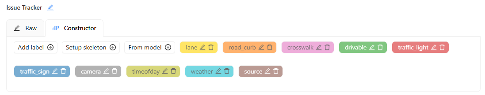
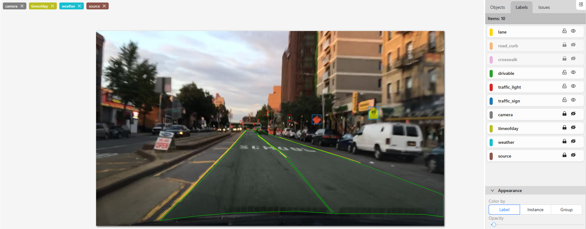
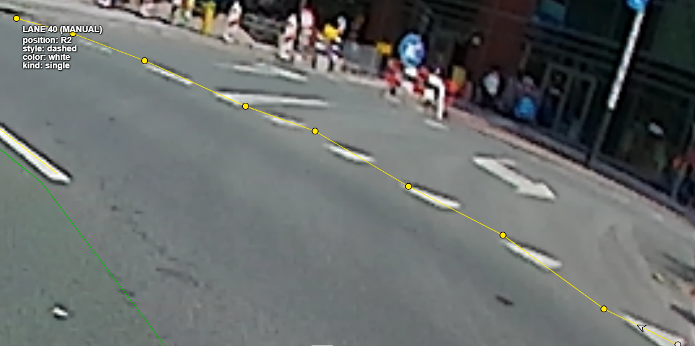
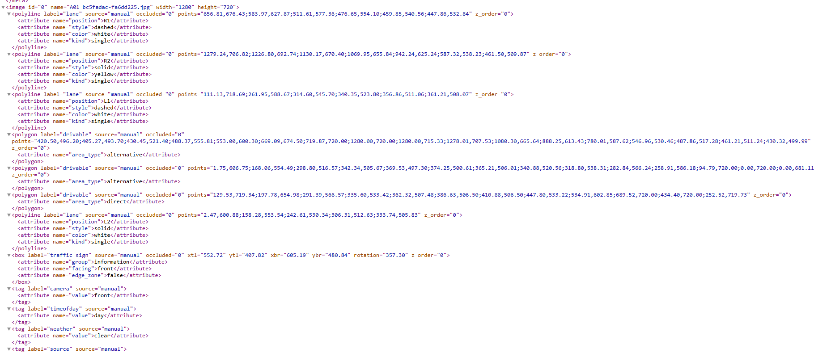

# Báo cáo cá nhân — Ngày 11
Họ tên: Nguyễn Tiến Đạt              Mã học viên: 2A202603289  
Phiên bản CVAT (Help → About): CVAT Local (Docker Compose)  
Guideline: Road v1.0    Lần nộp (`revision` trong manifest): 1  
Thời điểm export (ngày giờ trên CVAT): 2026-11-20T15:33:37+00:00 (UTC)   Số lần nộp lại sau Rework: 0  
Link Google Drive chứa 2 tệp zip nhãn (`nguyentiendat-2A202603289-front.zip` và `nguyentiendat-2A202603289-fisheye.zip`): https://drive.google.com/drive/folders/1UrYz5vQKJpx5CX2NkkJL2ERDnr74Qd9W?usp=drive_link  

## 1. Kiểm project
| Mục | Đúng như guideline Road v1.0? | Ghi chú |
| --- | --- | --- |
| 6 label, đúng kiểu | Đúng | `lane` (polyline), `road_curb` (polyline), `crosswalk` (polygon), `drivable` (polygon), `traffic_light` (rectangle), `traffic_sign` (rectangle) — tạo trực tiếp từ JSON của `python -m road_lab.taxonomy` |
| Thuộc tính và giá trị | Đúng | Đầy đủ thuộc tính `select` và `checkbox` (`edge_zone`), `mutable = false`, đúng giá trị mặc định theo `src/road_lab/taxonomy.py` |
| 4 tag ảnh | Đúng | `camera`, `timeofday`, `weather`, `source` (mỗi tag có 1 thuộc tính select tên `value`) |
Cách kết thúc polyline trên bản CVAT này: Nhấn phím `N` (hoặc nhấp lại vào nút Draw new polyline / double-click điểm cuối).  
Cách đặt tag ảnh trên bản CVAT này: Chọn biểu tượng Tag ở thanh công cụ bên trái → chọn tên label Tag (`camera`, `timeofday`, `weather`, `source`) → nhấn **Add tag**, sau đó mở tab Objects/Details ở thanh bên phải để chọn đúng giá trị `value`.  

## 2. Số lượng đã gán
| Task | Ảnh | lane | road_curb | crosswalk | drivable | traffic_light | traffic_sign |
| --- | ---: | ---: | ---: | ---: | ---: | ---: | ---: |
| front | 12 | 27 | 7 | 11 | 20 | 32 | 21 |
| front-extra (đã làm 0 / 4) | 0 | 0 | 0 | 0 | 0 | 0 | 0 |
| fisheye | 8 | 4 | 1 | 9 | 4 | 6 | 4 |
| fisheye-extra (đã làm 0 / 4) | 0 | 0 | 0 | 0 | 0 | 0 | 0 |

## 3. Bảng ca khó
| Ảnh | Nhãn | Phân vân giữa | Đã chọn | Lý do |
| --- | --- | --- | --- | --- |
| A03 | `lane` / `traffic_light` | Bật `occluded` trên đoạn vạch bị che và màu của các cụm đèn nhỏ ở xa | Vẽ các đoạn vạch còn nhìn thấy; gán các cụm đèn xa chiều `front` | Ở độ phân giải 1280×720, các cụm đèn phía xa rất nhỏ và vạch R1 chỉ rõ từ đoạn giữa ảnh |
| A04 | `drivable` | Phân tách `direct` cho làn xe đang đi và vùng làn bên phải R1 / làn xe đạp sát lề | Gán `direct` cho làn xe mình giữa L1 (vàng đôi) và R1 (trắng đứt), kèm `road_curb` bên phải | Làn sát vỉa hè có ký hiệu làn xe đạp nên loại khỏi vùng `direct` của ô tô |
| A05 | `lane` (L1, R1) | Vẽ vạch giả theo hàng xe đỗ hay bỏ trống `lane` | Không vẽ `lane`, chỉ gán `drivable` (`direct`) và `crosswalk` | Mặt đường thực tế không kẻ vạch chia làn; theo guideline và CHECKPOINTS không tự suy diễn vạch từ hàng xe đỗ (miễn QC1-02) |
| A06 | `lane` (R1) | Có gán vạch R1 bên phải khi không thấy vệt sơn dọc hay không | Chỉ gán L1 (`yellow`, `solid`), không gán R1; bổ sung `crosswalk` | Phía phải làn xe đang đi dưới gầm cầu không thấy vạch sơn dọc R1 rõ ràng |
| A07, A08 | `lane` (L1) & `traffic_light` | Đèn tín hiệu ở rất xa cao ~7–8 px có gán không; mép trái không thấy vạch sơn L1 | Gán cả các đèn nhỏ ở xa; chỉ gán vạch R1/R2 và `road_curb` | Đèn tín hiệu ở giao lộ xa xấp xỉ ngưỡng 8 px nên gán đủ để tránh bỏ sót (`lint` chỉ nhắc nhẹ box < 8 px không bắt buộc) |
| B01–B08 | `lane` / `crosswalk` trên ảnh fisheye | Vạch cong mạnh ở rìa ống kính fisheye và các vùng kẻ sọc dưới mặt đường | Gán polygon vùng qua đường và polyline theo cung ở các ảnh thấy rõ vạch (`B03`, `B04`, `B07`) | Ảnh fisheye biến dạng xuyên tâm lớn ở rìa ngoài 80% bán kính; thân xe mình ở mép ảnh được loại trừ không gán |

## 4. Phiếu QC 1 nhận được
Bạn kiểm lô của tôi: Lê Minh Thắng (`2A202603292`)   Quyết định nhận được: **Rework**  
| Mã lỗi | Số lỗi | Đồng ý? | Đã sửa? |
| --- | ---: | --- | --- |
| QC1-01 | 10 (thiếu 4 tag ở A10; tag `camera` ở B03–B08 để mặc định `fisheye_front`) | Đồng ý | Đã bổ sung đủ 4 tag cho A10–A12 và sửa đúng tag `camera` (`fisheye_rear`/`left`/`right`) cho toàn bộ B03–B08 |
| QC1-03 / QC1-05 | 3 (trùng `position` L1/R1 ở A01, A08, A10) | Đồng ý | Đã sửa đúng thứ tự `L1`, `L2`, `R1`, `R2` ở A01, A08, A10 |
| QC1-07 | 5 (thiếu `crosswalk` ở A04–A06, A08–A12) | Đồng ý | Đã bổ sung polygon `crosswalk` cho các ảnh có vạch qua đường |
| QC1-12 | 10 (chưa gán A11, A12 và B01–B08 ở lần kiểm đầu) | Đồng ý | Đã gán xong toàn bộ 20/20 ảnh bắt buộc (A01–A12 và B01–B08) |

## 5. Kiểm file export
- **Link Google Drive lưu trữ 2 file zip export:** [https://drive.google.com/drive/folders/1UrYz5vQKJpx5CX2NkkJL2ERDnr74Qd9W?usp=drive_link](https://drive.google.com/drive/folders/1UrYz5vQKJpx5CX2NkkJL2ERDnr74Qd9W?usp=drive_link)

| File | Mở lại được? | Số shape ảnh 1 (job / file) | Số shape ảnh 2 (job / file) | Tag camera có trong XML? |
| --- | --- | --- | --- | --- |
| `nguyentiendat-2A202603289-front.zip` | Có (`contains_images: false`) | A01: 8 / 8 (`drivable` 3, `lane` 4, `traffic_sign` 1) | A02: 7 / 7 (`drivable` 2, `lane` 3, `road_curb` 2) | Có (`<tag label="camera"><attribute name="value">front</attribute></tag>`) |
| `nguyentiendat-2A202603289-fisheye.zip` | Có (`contains_images: false`) | B01: 2 / 2 (`crosswalk` 1, `drivable` 1) | B02: 4 / 4 (`crosswalk` 1, `drivable` 1, `traffic_light` 2) | Có (`<tag label="camera">...`) |

## 6. Ảnh chụp màn hình
1. Tab Labels của project `d11-road-nguyentiendat`:
   
2. Một ảnh camera trước đã gán đủ (làn, vùng lái, đèn/biển — ví dụ A03 hoặc A08):
   
3. Một ảnh fisheye đã gán, phóng to đoạn polyline cong (ví dụ B03 hoặc B04):
   
4. Một đoạn XML có `<polyline label="lane">` trích từ `nguyentiendat-front.zip/annotations.xml`:
   

```xml
<polyline label="lane" source="manual" occluded="0" points="0.80,602.07;345.00,504.20" z_order="0">
  <attribute name="position">L1</attribute>
  <attribute name="style">solid</attribute>
  <attribute name="color">white</attribute>
  <attribute name="kind">single</attribute>
</polyline>
```

## 7. Tự đánh giá
- **Lỗi bạn mắc nhiều nhất hôm nay (theo mã QC1-xx), và cách tránh ở Ngày 20:**
  - Lỗi dễ mắc nhất là **QC1-01 / QC1-03 / QC1-06** do cơ chế tự điền giá trị mặc định của CVAT (mọi polyline mới tạo đều mang mặc định `L1 / solid / white / single`, và tag `camera` dễ bị giữ giá trị đầu tiên như `fisheye_front` khi chuyển từ ảnh `FV` sang `RV`, `MVL`, `MVR`), cùng với **QC1-05** (tách một biên làn có đoạn đứt/liền thành 2 polyline cùng `position`).
  - **Cách tránh ở Ngày 20:** Thực hiện nghiêm ngặt quy trình 6 bước ở mục 2 của Guideline: vừa đặt tag hoặc vẽ xong một polyline là mở ngay bảng Details bên phải để chỉnh `value` / `position` / `style` / `color` / `kind` trước khi vẽ hình tiếp theo; với ảnh fisheye, nhìn hậu tố tên file (`_FV`, `_RV`, `_MVL`, `_MVR`) ngay ở bước 1 để đặt đúng `camera` và đặt `position = other` cho mọi lane ở camera hai bên (`MVL`, `MVR`). Luôn chạy `road_check lint` trước khi chốt nộp để bắt ngay các lỗi tag và trùng `position`.
- **Nhãn của bạn đi vào model ở đâu? Chọn một lỗi đã sửa và nói nó làm model học sai thế nào:**
  - Nhãn `lane`, `drivable`, `traffic_light`, `traffic_sign` đi trực tiếp vào làm **ground-truth target ($\hat{y}$)** trong hàm mất mát (loss function) khi huấn luyện các mạng cảm nhận (Perception) của xe tự hành, chẳng hạn nhánh **Lane Detection theo kiến trúc Row-Anchor** (như Ultra-Fast Lane Detection) hoặc nhánh **Drivable Area Segmentation**.
  - **Ví dụ lỗi gây học sai:** Nếu gán nhầm `position` (QC1-03 — ví dụ đổi chỗ `L1` và `L2` hoặc gán 2 vạch khác nhau cùng là `R1`) hay vẽ `drivable` (`direct`) tràn lên thân xe đỗ bên lề (QC1-07), thì:
    1. Với **Row-Anchor Lane Keeping (LKA)**: tại mỗi hàng neo $y_i$, model phân loại vị trí cột $x$ cho kênh `L1`/`R1` sẽ bị ép học tọa độ của làn kế bên (`L2`/`R2`). Khi chạy thực tế, bộ điều khiển giữ làn sẽ tính tâm làn xe mình bị lệch hẳn sang làn bên cạnh, dẫn tới đánh lái sai làn.
    2. Với **Drivable Area Segmentation**: nếu polygon `direct` trùm lên dải xe đỗ, hàm Cross-Entropy/Dice Loss sẽ phạt model khi nó dự đoán xe đỗ là vật cản, khiến model học rằng phần không gian có xe đỗ vẫn là mặt đường trống đi thẳng vào được, gây nguy cơ va chạm trực tiếp.

## 8. (Tùy chọn, buffer) Từ polyline đến đích row-anchor
Kết quả chạy `PYTHONPATH=src python -m road_lab.rowanchor nguyentiendat-front.zip --image A01` (với `lane#0@(657,676)` có `position=R1`):

| y | 720 | 680 | 640 | 600 | 560 |
| --- | ---: | ---: | ---: | ---: | ---: |
| x của chúng tôi (`lane#0`, vạch đứt R1) | không có làn | không có làn | 602.2 | 544.0 | 485.5 |
| x của bạn kia | *(điền khi đối chiếu)* | | | | |

Trả lời 3 câu:

1. **Năm số x đó chính là đích mà một model row-anchor học cho vạch này. Nếu bạn dừng polyline sớm 40 px, hàng nào đổi thành "không có làn"?**
   - Nếu dừng polyline sớm 40 px theo trục dọc $y$:
     - Ở đầu gần xe: `lane#2` dừng ở $y = 676.0$ (thay vì kéo tới đáy ảnh $y = 720$), nên cả hai hàng neo **$y = 720$ và $y = 680$** đều nằm ngoài đoạn polyline và bị đổi thành **"không có làn"** (model bị dạy sai rằng ngay trước mũi xe không có vạch làn). Nếu dừng sớm thêm 40 px nữa (tới $y < 640$) thì hàng **$y = 640$** cũng mất nhãn.
     - Ở đầu xa xe: nếu dừng sớm 40 px trước $y = 560$ (ví dụ dừng ở $y = 590$), thì hàng neo **$y = 560$** sẽ đổi thành **"không có làn"**.
2. **So với bạn được kiểm (cùng ảnh): ở hàng 720 và hàng 560, hai bạn lệch nhau bao nhiêu pixel? Lệch ở hàng nào ảnh hưởng LKA nhiều hơn (slide 25)?**
   - **Lệch ở hàng $y = 720$ (gần mũi xe) ảnh hưởng đến hệ thống giữ làn (LKA — Lane Keeping Assist) nhiều hơn rất nhiều so với ở hàng $y = 560$ (ở xa).**
   - Lý do: Hàng $y = 720$ nằm ngay sát cản trước của xe, dùng để tính **độ lệch ngang tức thời (lateral offset / cross-track error $e_y$)** của xe so với tâm làn. Sai số vài pixel hoặc mất nhãn ("không có làn") ở $y = 720$ làm bộ điều khiển đánh lái phản ứng sai ngay lập tức; trong khi hàng $y = 560$ ở xa chủ yếu cung cấp thông tin độ cong (curvature/heading preview) phía trước và ở xa thì 1 pixel ứng với khoảng cách thực tế lớn hơn nhiều nhưng đã được làm mượt qua bộ lọc quỹ đạo.
3. **Nếu polyline vẽ từ xa về gần (ngược quy tắc 2), cách tính trên có đổi không? Script nào sẽ gặp khó?**
   - Với riêng phép nội suy tuyến tính theo từng đoạn thẳng cắt ngang hàng $y$ trong `rowanchor.py` (kiểm tra `(y1 <= r <= y2) or (y2 <= r <= y1)`), giá trị tọa độ $x$ nội suy tại một hàng $y$ trên một đoạn thẳng đơn lẻ không đổi nếu chỉ đảo thứ tự hai đầu đoạn.
   - **Tuy nhiên**, các script phụ thuộc vào **hướng tham số hóa theo chiều dài cung $s$ từ điểm đầu `points[0]` (gần xe) tới điểm cuối `points[-1]` (xa xe)** sẽ gặp lỗi ngay:
     - Cụ thể là **`road_check.py`** (`_lanes` và `lint`): script kiểm tra `s1 < s0` (chiếu `pts[0]` và `pts[-1]` lên GT) và kiểm tra `s.points[0][1] < s.points[-1][1]`, cũng như đo khoảng cách `d_near = math.dist(pts[0], g.points[0])` và `d_far = math.dist(pts[-1], g.points[-1])`. Nếu vẽ từ xa về gần, `pts[0]` lại nằm ở chân trời nên `d_near` và `d_far` bị tính chéo đầu, đồng thời bị bắt lỗi chính **QC1-04 ("vẽ ngược chiều (phải từ gần xe ra xa)")**.
     - Ngoài ra, các pipeline huấn luyện model dạng chuỗi điểm tuần tự (autoregressive / spline fitting từ đầu xe ra xa) hoặc ghép nối nhiều đoạn `_merge` theo điểm đầu `p.points[0]` cũng sẽ nối sai thứ tự hình học.
